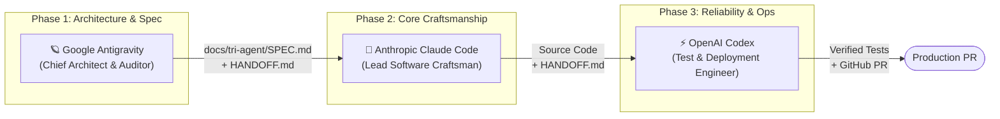

# 🛸 Tri-Agent Orchestrator

[](https://opensource.org/licenses/MIT)
[](#agent-matrix)
[](#installation)

> **Multi-agent orchestration framework and universal agent skill coordinating Google Antigravity (`agy`), Anthropic Claude Code (`claude`), and OpenAI Codex (`codex`).**

---

## 🌟 Why Tri-Agent Orchestration?

No single AI coding assistant is optimal for every phase of software engineering. Complex software requires diverse cognitive strengths:

* **Google Antigravity (`agy`)** excels at deep codebase reconnaissance, multimodal architecture design, complex dependency analysis, and adversarial edge-case auditing.
* **Anthropic Claude Code (`claude`)** excels at nuanced semantic reasoning, high-taste code craftsmanship, domain modeling, and surgical refactoring.
* **OpenAI Codex (`codex`)** excels at rapid execution, test harness generation, terminal build commands, CI/CD pipeline authoring, and deterministic regression fixes.

**Tri-Agent Orchestrator** connects all three into a synchronized pipeline using standardized inter-agent contracts (`HANDOFF.md`), preventing hallucination cascades and delivering production-ready, verified code.

---

## 🔄 Core Architecture



---

## 📊 Agent Specialization Matrix

| Agent CLI | Primary Role | Cognitive Superpower | Responsibilities in Workflow |
| :--- | :--- | :--- | :--- |
| **`agy`** (Antigravity) | **Chief Architect & Auditor** | Multimodal analysis, dependency graphs, security modeling | • System architecture & RFC drafting<br>• Adversarial edge-case discovery<br>• Visual UI/UX verification |
| **`claude`** (Claude Code) | **Lead Software Craftsman** | Architectural taste, clean abstractions, contextual refactoring | • Domain logic & API implementation<br>• Technical debt refactoring<br>• Clean code patterns & documentation |
| **`codex`** (Codex CLI) | **Reliability & Ops Engineer** | Fast execution, test generation, build systems, bash tooling | • Unit & integration test suites<br>• Linting & typecheck fixes<br>• Git commits & PR preparation |

---

## 🚀 Quickstart in 60 Seconds

### 1. Clone & Setup
```bash
git clone https://github.com/abhigyan6/tri-agent-orchestrator.git
cd tri-agent-orchestrator
```

### 2. Verify Your Environment
Check if all three agent CLIs and developer tools are ready:
```bash
./bin/tri-agent doctor
```

Output:
```text
=======================================================
 🛸 Tri-Agent Orchestrator: Environment Doctor
=======================================================

Coding Agents Status:
  ✅ Google Antigravity (agy)          : 1.5.4
  ✅ Anthropic Claude Code (claude)    : 2.1.322
  ✅ OpenAI Codex (codex)              : 0.167.0

Status Summary:
  🎉 All 3 agent CLIs (Antigravity, Claude Code, Codex) are active and ready!
```

### 3. Register the Skill Globally
Install or symlink the skill so Antigravity, Claude Code, and Codex can use it natively:
```bash
./scripts/install-skill.sh
```

---

## 🧪 Running the Tests

```bash
python3 -m unittest discover -s tests -v
```

The suite uses only the standard library and does not invoke any agent CLI.

---

## 📋 The Inter-Agent Handoff Contract (`HANDOFF.md`)

Whenever an agent concludes its phase, it produces or updates `HANDOFF.md` in the repository root:

```markdown
# Tri-Agent Handoff Contract

## Metadata
- **Workflow ID:** `wf-20261110-a9f3b1`
- **Active Feature:** `auth-middleware`
- **Current Phase:** `Phase 1: Architecture & Specification`
- **Completed By:** `agy`
- **Next Agent:** `claude`
- **Timestamp:** `2026-11-10T16:00:00Z`

## What Was Done
- Designed RS256 token rotation architecture.
- Outlined CSRF defense and SameSite=Strict cookie invariants.

## Key Files & Artifacts
- Specification: `docs/tri-agent/SPEC-auth.md`

## Critical Constraints & Decisions
- Token expiration: 15 minutes access, 7 days refresh.
- No third-party heavy dependencies; use native Web Crypto or jose.

## Verification Checklist for Next Agent
- [ ] Implement `src/middleware/auth.ts` matching `SPEC-auth.md`.
- [ ] Export `AuthRequest` and `TokenPayload` types.
- [ ] Update `HANDOFF.md` and set Next Agent to `codex`.
```

---

## 🛠️ Tri-Agent CLI Usage

The repository includes a dedicated CLI helper (`bin/tri-agent`):

```bash
# Check system health across all 3 agent CLIs
tri-agent doctor

# Install the skill to ~/.agents/skills, ~/.claude/skills, and ~/.codex/skills
tri-agent install-skill

# Summarize the handoff in the current project (metadata + checklist progress); --raw prints the full file
tri-agent handoff status

# Initialize a new handoff contract
tri-agent handoff create --feature "rate-limiter" --completed agy --next claude

# Run a workflow: relay (default), debate, or audit
tri-agent run --workflow relay --prompt "Build modern auth middleware with JWT rotation"
tri-agent run --workflow debate --prompt "Choose a session store for the cart"
tri-agent run --workflow audit --feature uploads --prompt "Harden the file upload endpoint"

# Preview the exact commands without invoking any agent
tri-agent run --workflow relay --prompt "Build file upload component" --dry-run
```

**Requirements:** Python 3.9+ (standard library only, no `pip install` step).

## 🛡️ Safety Model

Every stage is checked before the next agent starts. A run stops at the first violation, and `tri-agent run` exits non-zero so it can gate scripts and CI.

| Check | What it enforces |
| :--- | :--- |
| **Artifacts** | Each step's expected files (for example `docs/tri-agent/SPEC-<feature>.md`) exist and are non-empty. |
| **Handoff** | `HANDOFF.md` was rewritten by this step, with the expected `Completed By` and `Next Agent`. A stale file from an earlier run does not count. |
| **Write scope** | The read-only-by-intent auditor may only change `docs/tri-agent/` and `HANDOFF.md`. Any other git-visible change stops the run. |
| **Concurrency** | A lock at `tmp/tri-agent/run.lock` stops a second run in the same repository. A stale lock from a dead process is taken over. |
| **Audit trail** | Every agent's prompt and output is saved under `tmp/tri-agent/runs/<timestamp>-<feature>/`. |

The write-scope check is **detection, not prevention**. An agent can still edit a forbidden file during its turn. The run then stops and reports the path, but the edit stays in the working tree for you to review or revert.

**Permissions for headless runs.** Each step passes the agent's own permission mode:

| Agent | Edit steps | Command |
| :--- | :--- | :--- |
| Claude Code | `--permission-mode acceptEdits` | `--print` |
| Codex | `--sandbox workspace-write` | `exec` |
| Antigravity | `--mode accept-edits` | `--print` |

Edits are allowed, but **shell commands are not auto-approved**. Headless Claude Code and Antigravity deny tool calls such as running tests unless you allow them. Antigravity's denial message points to `permissions.allow` in its `settings.json`. Granting that is a security decision for you, so this tool does not do it. Before relying on unattended test runs, do one supervised run per agent and confirm the test step actually executes; this has not been verified end to end.

**Output size.** Each agent call is limited to 600 seconds by default. Change it with `--timeout`.

---

## 📂 Repository Structure

```
tri-agent-orchestrator/
├── SKILL.md                            # Universal Agent Skill definition
├── README.md                           # Documentation & architecture guide
├── LICENSE                             # MIT License
├── init-repo.sh                        # Git initialization and GitHub push script
├── bin/
│   └── tri-agent                       # Executable CLI orchestrator
├── lib/
│   ├── agents.py                       # CLI invocation wrappers for agy, claude, codex
│   ├── __init__.py
│   ├── orchestrator.py                 # Handoff contracts, skill installation, environment checks
│   ├── templates.py                    # Renders templates/ files with {{PLACEHOLDER}} values
│   └── workflows.py                    # Relay / debate / audit stage planning and execution
├── workflows/
│   ├── 01-relay-pipeline.md            # Research -> Build -> Verify pipeline
│   ├── 02-parallel-debate.md           # Multi-agent architecture consensus
│   └── 03-redteam-audit.md             # Implementation & adversarial red-team audit
├── templates/
│   ├── HANDOFF.template.md             # Handoff contract (single source of truth)
│   └── AGENT_SPEC.template.md          # Architectural spec schema template
├── examples/
│   ├── auth-middleware-walkthrough.md  # Auth middleware walkthrough
│   └── file-upload-spec-walkthrough.md # File upload walkthrough
├── .github/workflows/
│   └── ci.yml                          # Tests on Python 3.9 and 3.12, dry-run smoke test
├── tests/
│   └── test_tri_agent.py               # Unit tests (standard library only)
└── scripts/
    └── install-skill.sh                # Cross-agent skill installation (delegates to bin/tri-agent)
```

---

## 🤝 Prompting the Agents

Once the skill is active, you can invoke your workflows naturally:

### In Antigravity:
```text
"Run the tri-agent workflow to research and build a modern auth middleware for my app."
```

### In Claude Code:
```text
"Read HANDOFF.md and implement the components outlined in docs/tri-agent/SPEC.md."
```

### In OpenAI Codex:
```text
"Check HANDOFF.md, write unit and edge-case tests for the new auth middleware, and verify they all pass."
```

---

## 📄 License

Distributed under the [MIT License](LICENSE).
