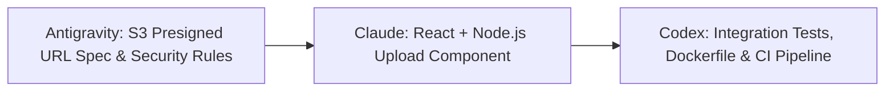

# Walkthrough: Secure File Uploads Pipeline

This walkthrough demonstrates the execution of the prompt:
> *"Have Antigravity research the best practices for file uploads, pass the spec to Claude to build the component, and have Codex review and prepare deployment."*

---

## Architecture Flow

### 1. Antigravity Phase (Specification & Security)
- Researches direct-to-S3 presigned URL architecture (avoiding server memory buffering).
- Mandates MIME-type magic byte validation (not just file extension check).
- Sets 10MB chunking policies.
- Outputs `docs/tri-agent/SPEC-file-upload.md` and initializes `HANDOFF.md`.

### 2. Claude Code Phase (Component Craftsmanship)
- Implements `components/FileUpload.tsx` (drag-and-drop, progress bar, error state).
- Implements `pages/api/upload/presign.ts` generating signed PUT URLs with content length limits.
- Updates `HANDOFF.md` designating Codex as next agent.

### 3. OpenAI Codex Phase (Review & Deployment)
- Runs code review for memory leaks or unhandled errors.
- Generates component test in `tests/FileUpload.test.tsx` using Mock Service Worker (MSW).
- Verifies AWS IAM least-privilege policy for S3 bucket upload.
