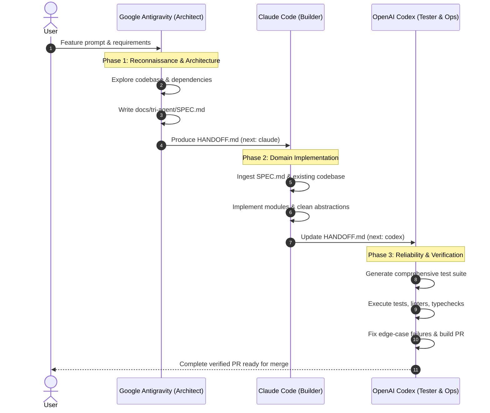

# Workflow 01: The Relay Pipeline (Research → Build → Verify)

The **Relay Pipeline** is the standard end-to-end production workflow. Each agent handles the phase matching its greatest architectural and engineering strengths.

---

## Phase Details

### Phase 1: Research, Architecture & Specification
- **Agent:** Google Antigravity (`agy`)
- **Key Actions:**
  - Map existing project architecture and identify affected modules.
  - Review best practices, security standards, and API boundaries.
  - Formulate the design document into `docs/tri-agent/SPEC.md`.
  - Initialize `HANDOFF.md` with strict invariants, type interfaces, and success criteria.

### Phase 2: Production Craftsmanship & Implementation
- **Agent:** Anthropic Claude Code (`claude`)
- **Key Actions:**
  - Read `docs/tri-agent/SPEC.md` and `HANDOFF.md`.
  - Implement idiomatic, clean, readable code with zero premature optimization.
  - Structure modules for high maintainability.
  - Update `HANDOFF.md` logging all created and modified source files.

### Phase 3: Test Suite Generation, Verification & Deployment
- **Agent:** OpenAI Codex (`codex`)
- **Key Actions:**
  - Read `HANDOFF.md` and examine new code.
  - Generate unit tests, integration tests, and edge-case mocks.
  - Execute test commands (`npm test`, `pytest`, `cargo test`, etc.).
  - Fix any syntax errors or test regressions.
  - Prepare git commit and GitHub PR summary.
