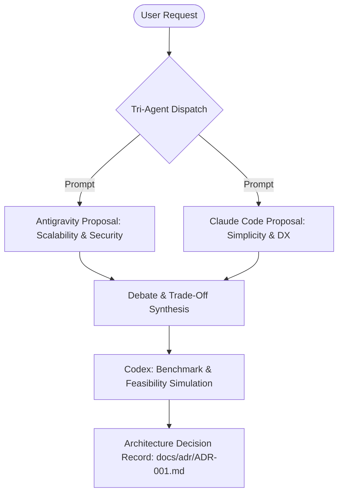

# Workflow 02: Parallel Architecture Debate & Consensus

Use this workflow when making critical system design decisions with high architectural impact:
- Choosing between SQL (PostgreSQL) vs Document (MongoDB) vs Key-Value (DynamoDB).
- Choosing state management (Zustand vs Redux Toolkit vs Signals).
- Designing authentication flows (OAuth 2.1 PKCE vs Session Cookies).

## Protocol Steps
1. **Parallel Pitch:**
   - `agy` produces Proposal A (emphasis: failure modes, security guarantees, future scale).
   - `claude` produces Proposal B (emphasis: simplicity, developer velocity, refactorability).
2. **Review & Critique:**
   - Each agent reviews the other's proposal and flags risks.
3. **Synthesis & ADR:**
   - Consensus recommendation is written to `docs/adr/ADR-xxx.md`.
