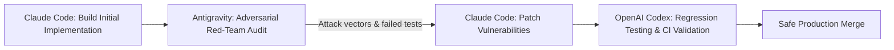

# Workflow 03: Adversarial Red-Team Audit

Use this workflow for security-critical logic, financial calculations, encryption routines, and authorization middlewares.

## Security Audit Checklist (Antigravity Role)
- [ ] Authentication & Session tampering (JWT replay, algorithmic confusion).
- [ ] Authorization & IDOR (accessing resources without tenant ownership check).
- [ ] Injection attacks (SQL, NoSQL, Command, Template, Header injection).
- [ ] Denial of Service & Resource exhaustion (unbounded loop, uncompressed payload, memory leaks).
- [ ] Sensitive Data Exposure (API keys in logs, stack traces in production errors).
